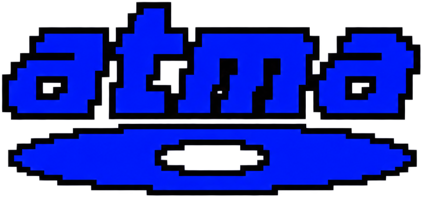

<p align="center">
  
</p>

# WHAT

`atma` is _intended_ to be a cross-platform game engine that targets classic
retro computers, but which can also build on modern PCs.

(TODO)

# REQUIREMENTS

## PC

- A C99 compiler (gcc is what the Makefile uses)
- GNU make
- pkg-config
- SDL3 (3.4 or newer, with development headers)
- Python 3 (to run tools/mkpats.py, the asset generator; standard library only)

## Documentation

- **Doxygen** - `sudo zypper install doxygen`. Parses the C sources and emits
  XML only; HTML output is disabled because Zensical renders the site.
- **doxybook2** v1.5.0 - no distro package. Take
  `doxybook2-linux-amd64-v1.5.0.zip` from
  github.com/matusnovak/doxybook2/releases, unzip it, and put `bin/doxybook2`
  on `PATH` (e.g. `sudo install -m755 bin/doxybook2 /usr/local/bin/`).
  Converts the Doxygen XML into Markdown.
- **Zensical** - `pipx install zensical` (needs Python 3.11+). Builds the
  unified site from `docs/`.

## ZX Spectrum Next (PLATFORM=zxn)

- The **z88dk** toolchain, built from source (distro packages are too old
  for the Next's Z80N instructions and SDCC variant). A git checkout
  built with `./build.sh`; the tree this repo is developed against is
  `~/work/z88dk` (v2.5+, current-ish master).
- Two environment variables, from z88dk's `set_environment.sh`:

  ```
  export PATH=~/path/to/z88dk/bin:$PATH
  export ZCCCFG=~/path/to/z88dk/lib/config
  ```

  `ZCCCFG` is the one that bites: without it `zcc +zxn` cannot find the
  zxn target config and dies confusingly.
- Binaries a zxn build actually touches, all from that `bin/`: `zcc`
  (frontend that drives everything), `zsdcc`/`z88dk-zsdcc` (the SDCC
  compiler proper), `z80asm`, `z88dk-ucpp` (preprocessor), `z88dk-copt`
  (peephole pass), `z88dk-appmake` (produces the `.nex`).
- Build prerequisites for z88dk itself: `gcc`/`clang`, `make`, `autoconf`,
  `libxml2` and its dev headers, `boost` and its dev headers, git. The
  build is long; see z88dk's docs.
- **zxnext_sprite** (github.com/stefanbylund/zxnext_sprite): the reference
  C API and documentation for the Next's hardware sprites. The engine's
  gfx backend drives the I/O ports directly (mirroring this repo's
  slot-select, attribute and pattern-upload flows), so it is a
  documentation and cross-check dependency rather than a link dependency.
  A clone of the repo serves as that reference.
- Running the output: a `.nex` file boots on real Next hardware (from the
  SD card menu) or in an emulator. `make PLATFORM=zxn GAME_DIR=demo run`
  boots it in ZEsarUX, the native Linux Next emulator (CSpect works too,
  under WINE). ZEsarUX is looked up on PATH; override with
  `ZESARUX=/path/to/zesarux` if it lives elsewhere. Note that ZEsarUX
  loads its machine ROMs from the real binary's own directory, so a
  symlinked path can fail ROM loading; point at the real binary if so.

# DESIGN NOTES

## One palette, the Next's colors

The engine is indexed-color everywhere: you set palette entries with
`atma_gfx_palette_set()` (RGB333, the Next's 9-bit color space, 512
colors) and every color drawn is an index into that table. The host is not
more capable than the Next here: it quantizes to the same 512-color space,
so what you see in the window is what the Next will show.

Palette entries are live state: change one and every pixel using that
index, sprites included, recolors on the next frame, on every platform.
Palette animation is portable.

Index 0 is the transparent color for sprites on every backend, by index:
sprite pixels holding value 0 draw transparent and entry 0's RGB is never
shown, on the host (alpha 0) and on the Next (the sprite transparency
index register, written 0 by the zxn backend).

## Assets are compiled in

Games don't load image files at runtime. `tools/mkpats.py` converts a PNG
into generated C: a palette table plus 16x16 cell patterns of palette
indices (the Next's native sprite atom). Both backends consume the same
bytes, so the demo builds unchanged for host and zxn. Regenerate after
editing the source image:

```
python3 tools/mkpats.py demo/atma.png demo/atma_patterns
```

# DOCS

```
make docs        # Doxygen -> XML, doxybook2 -> docs/api, Zensical -> build/docs/site
make docs-serve  # same, then serve on localhost:8000 with live reload
make docs-clean  # drop generated XML, Markdown and site output
```

`docs/` holds handwritten guides; `docs/api/` is generated from the sources by
doxybook2 and is gitignored, so never edit it by hand. Doxygen reads
`Doxyfile`, Zensical reads `zensical.toml`, and
`tools/doxybook2/templates/header.tmpl` overrides doxybook2's default page
frontmatter so summaries containing a colon stay valid YAML.

# DEMO

```
make GAME_DIR=demo run
```
