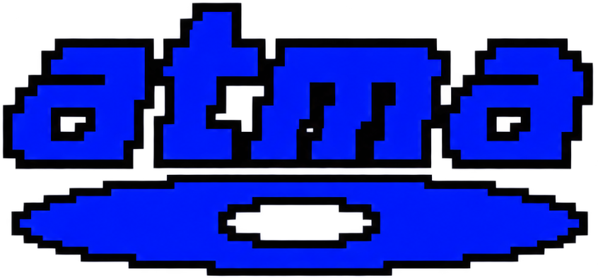

<figure markdown="span">

{ width="70%" }

</figure>

A cross-platform retro engine targeting classic computers, which also builds
on modern PCs. The engine is deliberate in its limitations.

It targets a max specification of the [ZX Spectrum Next](https://www.specnext.com/),
which is an idealized retro computer made in the modern age. It aims for feature
parity to what the ZX Spectrum Next offers:

* Maximum Resolution of *256x192* pixels
* 9-bit RGB333 color space (top 3 bits of red, green, and blue): 512 possible colors
    * 256 possible palettes
    * Palettes are live state: changing a palette recolors every drawn pixel that references it
    * Palettes have a max of 256 colors from the 9-bit color space
* Up to 128 sprites on screen
    * Sprites are 16x16 pixels
    * Scrolling and layer priorities

When a game or demo is built on PC, it will have the above limitations,
ensuring the game is identical to what it would be on ZX Spectrum Next.

# What does "atma" mean?

"Soul" - That's what it means.

I was listening to the vinyl for "Atma" by [My Sleeping Karma](https://www.mysleepingkarma.de/)
when I started working on this engine. It became the name of the engine because
I didn't want to think too hard about a name at the time.

In retrospect, it was serendipitous. This project stemmed from a collision of
mid-life crises:

* AI usage in my day job had drained the joy out of programming
* I wanted to make silly games and graphical demos in my free time for retro computers
* I was itching for a C project since the last 13 years have mostly been Python

My "soul", if there is such a thing, was trained on 8-bit computers of the 1980s.
Sitting in a dark, windowless, basement room coding silly things for my own
entertainment. `atma` allows me to return to my roots, and bring my soul joy.
